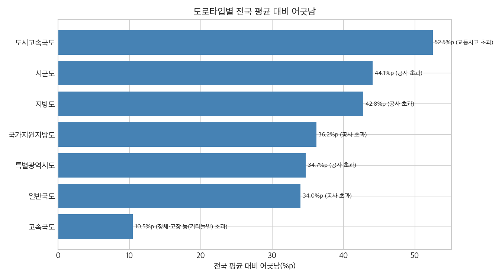
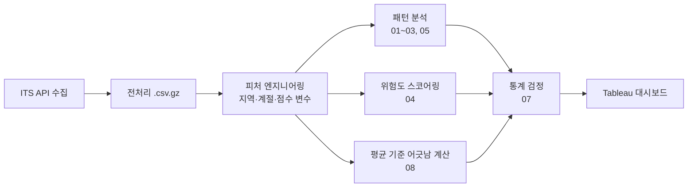

# 돌발 유형 기반 도로 대응 기준 설계
Road Incident Response Planning by Incident Type

> 같은 "도로 돌발"이라도 도시고속국도는 4건 중 3건(76.0%)이 사고, 국가지원지방도는 5건 중 3건(62.3%)이 공사다. 전국 평균만 보고 대비한다면 도시고속국도에서는 대응 자원의 52.5%p를 다른 유형에 맞게 다시 배치해야 할 만큼 어긋난다. 같은 도로타입 안에서도 평균과 20%p 이상 다른 노선이 41개 있다. 고속국도 130번은 공사가 60.4%(고속국도 평균 25.0%), 남부순환로는 사고가 85.1%(특별광역시도 평균 33.7%)다. 대응 자원은 도로타입·시간대별로 유형을 나눠 배치하고, 이런 예외 노선은 노선 단위로 따로 관리해야 한다.


▶ [Tableau Public에서 인터랙티브 버전 보기](https://public.tableau.com/views/_17658672451790/sheet7?:language=ko-KR&:display_count=n&:origin=viz_share_link)

## 한눈에 보기

| 항목 | 내용 |
|---|---|
| 문제 | 도로 종류·노선·시간대별로 어떤 돌발에 대비해야 하는지 구분된 기준이 없다 |
| 데이터 | ITS 국가교통정보센터 돌발정보, 623,188건(2024.11~2025.10) |
| 역할·기간 | 팀 프로젝트(3명) · 도로타입·도로번호 기준 패턴 분석(H1, H4) 담당 · 2025.11~12 |
| 기술 | Python, pandas, geopandas, scipy, statsmodels, Tableau |

## 목차

1. [문제 정의](#1-문제-정의)
2. [결과](#2-결과)
3. [제안](#3-제안)
4. [한계와 다음 단계](#4-한계와-다음-단계)
5. [판단 기록](#5-판단-기록)
6. [데이터](#6-데이터)
7. [분석 과정](#7-분석-과정)
8. [참고: 규칙 기반 위험도 점수](#8-참고-규칙-기반-위험도-점수)
9. [AI 활용 방식](#9-ai-활용-방식)
10. [재현 방법](#10-재현-방법)
11. [저장소 구조](#11-저장소-구조)
12. [역할](#12-역할)
13. [라이선스](#라이선스)

## 1. 문제 정의

| 구분 | 내용 |
|---|---|
| 현상 | 1년간 전국 도로에서 돌발상황 62.3만 건(하루 약 1,700건)이 발생했고, 사고·공사·고장·정체 등 성격이 다른 유형이 섞여 있다. |
| 문제 | 대응 인력과 장비는 한정돼 있는데, 도로 종류·노선·시간대별로 어떤 돌발에 대비해야 하는지 구분된 기준이 없다. 전체 평균을 기준으로 대응하면 실제로 많이 일어나는 유형과 어긋난다. |
| 목표 | 도로타입·노선·시간대별로 지배적인 돌발 유형을 찾아, 사고 대응·공사 관리·정체 대응 자원을 어디에 어떻게 나눠 둘지 근거를 만든다. |

## 2. 결과

#### 도로타입별로 지배적인 돌발유형이 정반대다

국가지원지방도는 공사가 62.3%, 도시고속국도는 교통사고가 76.0%, 고속국도는 기타돌발(정체·고장류)이 43.4%로 가장 많다. 카이제곱 독립성 검정 결과 χ²=159,429.6(df=35), p<0.001, Cramér's V=0.226(중간)로, 도로타입이 돌발 패턴을 가르는 실질적인 요인임을 확인했다.

#### 전국 평균 기준으로 대비하면 도로타입마다 어긋나는 정도가 다르다

도시고속국도는 전국 평균과 **52.5%p** 어긋나 가장 크고, 고속국도는 10.5%p로 전국 평균과 가장 비슷하다. 전국 평균은 고속국도가 77.7%를 차지해 사실상 고속국도 패턴이다. 나머지 6개 도로타입은 모두 이 평균과 23.7%p 이상 어긋난다.

| 도로타입 | 건수 | 어긋남(%p) | 가장 초과한 유형 |
|---|---|---|---|
| 도시고속국도 | 23,598 | 52.5 | 교통사고(+52.5%p) |
| 시군도 | 23,466 | 44.1 | 공사(+44.1%p) |
| 지방도 | 5,183 | 42.8 | 공사(+42.8%p) |
| 국가지원지방도 | 2,702 | 36.2 | 공사(+30.0%p) |
| 특별광역시도 | 43,892 | 34.7 | 공사(+23.7%p) |
| 일반국도 | 39,729 | 34.0 | 공사(+31.6%p) |
| 고속국도 | 483,758 | 10.5 | 정체·고장 등(기타돌발)(+9.3%p) |



전체 수치와 계산 방식은 [docs/average_mismatch.md](docs/average_mismatch.md) 참고.

#### 돌발 건수 피크와 사고 비중 피크가 다르다

전체 돌발 건수는 출근 시간대(07-09시)가 26.1%로 가장 많지만, 교통사고 비중만 보면 퇴근 시간대인 18시(38.1%)가 가장 높다. 카이제곱 독립성 검정 결과 χ²=18,226.9(df=23), p<0.001, Cramér's V=0.171로 효과는 작음~중간 수준이다. 건수가 몰리는 시간과 사고 위험이 몰리는 시간이 다르다는 뜻이다.


#### 같은 도로타입 안에도 평균과 크게 다른 예외 노선이 있다

고속국도 130번은 공사 비중이 60.4%(고속국도 평균 25.0%)이고, 특별광역시도 남부순환로는 교통사고 비중이 85.1%(특별광역시도 평균 33.7%)다. 둘 다 돌발 300건 이상인 108개 노선 중 어긋남 상위 10위 안에 들어 공식 집계의 대표 사례로 삼았다(130번 2,309건, 남부순환로 657건). 범위를 넓혀 같은 방식으로 계산하면 **41개 노선**이 같은 도로타입 평균과 20%p 이상 어긋나고, 이 41개 노선의 돌발 건수 합계는 37,019건으로 전체의 5.9%다. 도시고속국도 112번(74건, 공사 85.1%)과 지방도 1020번(45건, 교통사고 73.3%)은 건수가 300건 기준에 못 미치는 참고 사례이지만, two-proportion z-test에서는 둘 다 유의했다(112번 z=12.83, 1020번 z=9.05, 둘 다 p<0.001).

| 순위 | 도로타입 | 노선 | 건수 | 어긋남(%p) | 가장 다른 유형 |
|---|---|---|---|---|---|
| 1 | 특별광역시도 | 세종대로 | 547 | 68.3 | 기타(기상·재난·기타) |
| 2 | 특별광역시도 | 율곡대로 | 353 | 62.9 | 기타(기상·재난·기타) |
| 3 | 고속국도 | 500번 | 496 | 60.1 | 기타(기상·재난·기타) |
| 4 | 특별광역시도 | 남부순환로 | 657 | 51.4 | 교통사고 |
| 5 | 일반국도 | 48번 | 561 | 48.9 | 공사 |
| 6 | 특별광역시도 | 삼일대로 | 333 | 47.7 | 공사 |
| 7 | 특별광역시도 | 강남대로 | 372 | 46.2 | 공사 |
| 8 | 특별광역시도 | 반포대로 | 484 | 36.8 | 공사 |
| 9 | 고속국도 | 130번 | 2,309 | 36.4 | 공사 |
| 10 | 특별광역시도 | 노들대로 | 377 | 36.2 | 교통사고 |


상위 10개 중 7개가 특별광역시도 노선이라, 도로타입 평균 하나로는 설명되지 않는 노선별 편차가 작지 않다는 것을 보여준다. 전체 노선 표와 112번·1020번 참고 수치는 [docs/average_mismatch.md](docs/average_mismatch.md) 참고.

## 3. 제안

| 구분 | 제안 내용 |
|---|---|
| 도로타입별 | 도시고속국도는 퇴근 시간대(17-19시) 사고 예방 집중관리를, 국가지원지방도는 주간 공사의 야간 분산을, 고속국도는 상시 정체·고장 대응 인력 배치를 우선한다 |
| 노선별 | 112번·1020번처럼 도로타입 평균과 크게 다른 노선은 도로타입 단위 전략이 아니라 노선 전용 대응 계획을 따로 수립한다 |
| 시간대별 | 오전(06-12시)에는 순찰·초기대응 인력을 집중 배치하고, 퇴근 시간대(18-19시)에는 감속 유도와 사고 예방 현장대응을 강화한다 |
| 운영 데이터 개선 | 처리시간 기본값(30분) 문제를 해결하려면 종료시각 수동 확정 절차나 별도 플래그 컬럼을 추가해, 실제 대응 속도를 측정 가능한 지표로 분리한다 |

## 4. 한계와 다음 단계

- 텍스트 기반 위치·차로 판별의 누락 가능성: `돌발내용`이 자유 텍스트라 정규식으로 위치·차로 정보를 추출한다. 지명에 교(橋) 글자가 없는 교량명 등 일부 표현은 누락될 수 있다.
- 실제 교통량 데이터 부재: 돌발 건수만으로 분석했기 때문에, 교통량이 많아서 돌발이 많은 것인지 다른 요인 때문인지는 이 데이터만으로 구분할 수 없다.
- 위험도 배점의 미검증: 3절에서 밝혔듯 스코어링 배점 자체를 실제 2차 사고나 정체 시간으로 검증하지 못했다. 다음 단계로는 사고 후 교통량 변화 데이터를 확보해 배점을 보정하는 작업이 필요하다.
- 보고 체계 지연: 돌발이 사후 보고 형태로 입력되는 구조라 `돌발일시`가 실제 발생 시각보다 늦게 기록될 수 있다. 처리시간 30분 기본값 문제도 이 보고 체계와 무관하지 않을 것으로 보인다.
- 평균 기준 대비는 가정이다: 실제 도로관리기관이 전국 평균을 기준으로 대응을 설계한다는 근거는 없다. 도로 종류마다 관리 주체가 다르므로(고속국도는 한국도로공사, 국도는 국토교통부 산하 기관, 지방도·시군도는 지자체), 2절의 어긋남 수치는 평균 기준으로 대비한다면이라는 가정에서 나온 값이다.
- 돌발이 많은 노선이 반드시 위험한 노선은 아니다: 노선별 분석의 건수는 돌발 발생 빈도일 뿐, 교통량 대비 발생률이나 사고 심각도를 반영하지 않는다. 교통량 데이터가 없어 돌발이 많은 도로를 바로 위험한 도로로 단정할 수 없다.

다음 단계로는 교통량 대비 돌발률을 계산하고, 실제 대응 자원 배치 자료와 비교해 제안의 타당성을 검증하는 작업이 필요하다.

## 5. 판단 기록

| 상황 | 선택 | 이유 | 결과 |
|---|---|---|---|
| 위경도를 시/도 단위 지역으로 분류해야 했다 | 17개 시/도 대표 좌표와의 거리 비교(최근접 중심점 근사) 대신 실제 행정경계 polygon과의 point-in-polygon(점이 다각형 내부에 있는지 판별하는 방법) 매칭을 선택했다 | 서울처럼 면적이 작고 경기도로 둘러싸인 지역은 중심점 거리 비교 방식으로는 실제로 경기도에 속한 좌표까지 서울로 잘못 배정하는 문제가 있었다 | `region_mapping.py`에서 통계청 SGIS 시/도 경계로 point-in-polygon 매칭을 하고, 경계 밖 좌표(약 0.3%)만 최근접 시/도로 보완했다 |
| 돌발종료일시로 처리시간을 계산하니 모든 도로타입의 중앙값이 30분으로 똑같이 나왔다 | 평균이 아니라 중앙값·Q1·Q3를 기준 지표로 바꾸고, 30분 정확히 기록된 값을 별도로 표시했다 | 평균은 공사 카테고리의 극단치(종료일시가 수개월~수년 뒤로 기록된 사례, 최대 약 2.7년)에 쉽게 흔들렸고, 30분 값이 처리 완료 건의 59.3%를 차지해 실측값이 아닌 시스템 기본값으로 의심됐다 | 30분 값을 제외하고 재계산하자 도로타입별로 32분부터 180분까지 실제 차이가 드러났다 |
| 특별광역시도·시군도는 도로번호 기준 분석이 불가능했다 | 도로번호 대신 도로명을 기준으로 상위 노선을 추렸다 | 두 도로타입은 다수의 일반 도로가 `도로번호=0`으로 통합 기록돼 있어, 번호로는 개별 노선을 구분할 수 없었다 | 세종대로(기타 76.8%), 구암대로(공사 61.7%)처럼 도로명 기준으로도 도로타입 평균과 다른 예외 노선을 확인했다 |
| 표본이 62만 건이라 카이제곱 검정의 p-value가 거의 0으로 나왔다 | p-value 대신 Cramér's V(효과크기)를 함께 보고하고, 효과크기가 작은 경우(H2)는 그대로 "효과는 작다"고 썼다 | p-value만 보면 큰 표본에서는 통계적 유의성이 과장되기 쉬워, 실질적인 연관성 크기를 별도로 봐야 했다 | H1은 중간 효과(V=0.226), H2는 작음~중간 효과(V=0.171)로 구분해 해석했다 |
| 위험도 스코어링 결과를 "위치·차로통제·시간대가 결합될수록 위험도가 커진다"는 핵심 가설로 검증하려 했다 | 위험도 점수를 핵심 가설에서 8절 참고 지표로 내렸다 | 돌발유형 점수에서 사고가 최고점(25점)을 받는 구조라, 위험도가 커진다는 결과가 배점 설계 단계에서 이미 일부 정해져 있었다 | 위험도 스코어링은 참고 지표로 남기고, 핵심 가설(H1·H2·H4)과 분리해 해석했다 |
| 전국 평균 기준으로 도로타입별 어긋남을 계산하려 했는데, 도로 종류마다 관리 주체가 달라 전국 평균 하나를 기준으로 삼는 것이 타당한지 애매했다 | 전국 평균 vs 도로타입(2절), 도로타입 평균 vs 노선(2절) 두 단계로 나눠 계산하고, 결과를 평균 기준으로 대비한다면이라는 가정형으로만 해석했다 | 관리 주체가 다른 도로끼리 하나의 전국 평균으로 비교하면 실제 운영 기준과 맞지 않을 수 있어, 비교 기준을 같은 도로타입 안으로 한 번 더 좁힐 필요가 있었다 | 도시고속국도(52.5%p)처럼 전국 평균과 크게 어긋나는 도로타입뿐 아니라, 같은 도로타입 안에서도 41개 노선이 20%p 이상 어긋난다는 두 수준의 결과를 모두 확인했다 |
| 기존 대표 사례인 112번·1020번이 연간 74건·45건으로 표본이 작았다 | 300건 이상 노선만 공식 집계하고, 대표 사례를 130번(2,309건)·남부순환로(657건)로 교체했다 | 표본이 작은 노선은 몇 건의 차이로도 비율이 크게 흔들려 대표 사례로 쓰기에 근거가 약하다 | 112번·1020번은 참고 사례로 남기고, 결론은 표본이 충분한 노선 기준으로 다시 썼다 |

## 6. 데이터

- 출처: [ITS 국가교통정보센터](https://www.its.go.kr) 오픈데이터 API(돌발정보)
- 수집기간: 2024-11-01 ~ 2025-10-31(1년, API 수집 기준)
- 규모: 원본 API 수집 636,320건, 전처리 후 623,188행 × 15개 컬럼
- 주요 컬럼: 돌발일시, 도로타입, 도로번호, 돌발구분, 돌발상세구분, 돌발내용(자유 텍스트), X/Y(경위도), 돌발종료일시
- 원본 파일 포함 방식과 전체 스키마는 [data/README.md](data/README.md) 참고

데이터 품질과 관련해 두 가지를 미리 밝힌다. 첫째, `돌발내용`이 반정형 자유 텍스트라 위치·차로 정보를 정규식으로 파싱해야 한다. 둘째, `특별광역시도`와 `시군도`는 `도로번호`가 항상 0으로 기록돼 있어 도로명으로 대체해야 한다(자세한 내용은 5절 판단 기록 참고).

## 7. 분석 과정

원본 자료는 팀이 작성한 보고서(30쪽)이며, 이 저장소는 그 분석을 직접 재현하고 통계 검정을 추가해 전체 파이프라인을 코드로 재정리한 것이다.



세운 가설과 검증 방법, 검정 결과는 핵심 가설, 보조 관찰, 데이터 품질 발견, 참고 지표로 나눠 정리했다. 전체 수치와 그림은 [docs/analysis_details.md](docs/analysis_details.md)에 있다.

#### 핵심 가설

| # | 가설 | 지표 | 검증 노트북 | 검정 결과 |
|---|---|---|---|---|
| H1 | 도로타입에 따라 주요 돌발유형 구성비가 다르게 나타난다 | 도로타입 × 돌발구분 교차표 | 03, 07 | 카이제곱 독립성 검정, χ²=159,429.6(df=35), p<0.001, Cramér's V=0.226(중간) |
| H2 | 돌발은 출근 시간대(07-09시)에 집중되고, 교통사고 비중은 퇴근 시간대(18-19시)에 최고치를 보인다 | 시간대 × 사고여부 교차표 | 02, 07 | 카이제곱 독립성 검정, χ²=18,226.9(df=23), p<0.001, Cramér's V=0.171(작음~중간) |
| H4 | 같은 도로타입이어도 특정 도로는 평균 패턴과 다른 고유 패턴을 보인다 | 노선별 돌발구분 비중 vs 도로타입 평균 | 05, 07, 08 | two-proportion z-test. 112번 z=12.83(85.1% vs 22.5%), 1020번 z=9.05(73.3% vs 19.3%), 둘 다 p<0.001. 08번 노트북에서 300건 이상 108개 노선으로 확장해 41개 노선이 20%p 이상 어긋남을 확인 |

표본이 623,188건으로 매우 커서 p-value는 H1·H2 모두 0에 가깝게 나온다. 표본이 클수록 아주 작은 차이도 통계적으로 유의하게 나오기 때문에, 연관성이 있는지 없는지는 p-value가 아니라 Cramér's V 같은 효과크기로 판단한다. H1은 중간 수준(V=0.226)으로 도로타입이 돌발구분을 가르는 실질적인 요인임을 뒷받침하지만, H2는 작음~중간 수준(V=0.171)에 그쳐 시간대가 사고 여부를 가르는 힘은 도로타입만큼 강하지 않다.

#### 보조 관찰

| # | 관찰 | 노트북 | 비고 |
|---|---|---|---|
| H3 | 계절적 요인에 따라 돌발 패턴이 다르다(가을은 공사, 여름은 사고) | 02 | 검정 없이 기술통계로 확인 |

#### 데이터 품질 발견

| # | 발견 | 노트북 | 비고 |
|---|---|---|---|
| H6 | 기록된 처리시간 중 상당수는 실제 처리시간이 아닌 시스템 기본값·보고 관행에 의한 아티팩트다 | 06 | 가설이 아니라 5절 판단 기록으로 연결 |

#### 참고 지표

| # | 지표 | 노트북 | 가설에서 제외한 이유 |
|---|---|---|---|
| H5 | 위치·차로통제·시간대가 결합될수록 위험도가 커진다 | 04 | 돌발유형 배점에서 사고가 최고점(25점)이라 결과가 배점 설계 단계에서 일부 정해져 있었다 |

## 8. 참고: 규칙 기반 위험도 점수

위치(0~20)·돌발유형(0~25)·차로통제(0~40)·시간대(0~15) 4개 항목을 정규식/키워드 기반으로 채점해 0~100점의 `risk_score`를 산출한다(평균 43.2점, 중앙값 43점). 돌발상세구분 중에서는 사고(61.1점)가 건당 위험도가 가장 높지만, 건수가 압도적으로 많은 작업이 총 위험기여도(빈도 × 평균위험도)로는 근소하게 앞선다. 다만 돌발유형 점수에서 사고가 최고점(25점)을 받는 구조라 "사고의 건당 위험도 1위"라는 결과는 배점 설계에서 비롯된 측면이 있고, 실제 2차 사고나 정체 시간 데이터로 배점 자체를 검증하지는 못했다. 전체 배점표와 상세 수치는 [docs/analysis_details.md](docs/analysis_details.md) 참고.

## 9. AI 활용 방식

팀 보고서의 분석을 코드로 재현하고 통계 검정과 평균 기준 어긋남 계산을 추가하는 과정에서 코드 작성과 실행은 AI(Claude Code)를 활용했다. 가설 구성, 판정 기준, 해석과 제안은 내가 정했다.

## 10. 재현 방법

```bash
pip install -r requirements.txt
jupyter notebook notebooks/
```

저장소에 gzip으로 압축된 전체 데이터(`data/incident_data.csv.gz`, 약 21.5MB)가 포함되어 있어 클론만 하면 별도 다운로드 없이 바로 실행할 수 있다. `src/load_data.py`의 `load()`가 이 파일을 자동으로 읽는다. 노트북은 01부터 08까지 순서대로 실행하면 된다(각 노트북 첫 셀에 목적·입력·출력·다음 노트북을 적어 뒀다).

## 11. 저장소 구조

```
.
├── data/                 # 전체 데이터(gzip), 샘플, 스키마 안내, 행정경계
├── docs/                 # 가설별 전체 수치·표, 평균 기준 어긋남 분석 상세 자료
├── src/                  # load_data / region_mapping / risk_scoring / constants / plot_config
├── notebooks/            # 01_eda ~ 08_average_mismatch
├── outputs/figures/      # 각 노트북 실행 결과 PNG
└── requirements.txt
```

## 12. 역할

3명으로 구성된 팀 프로젝트였다(2025.11~12). 팀 내에서는 도로타입·도로번호 기준 패턴 분석(H1, H4)과 해당 노트북을 담당했다. 도로타입별 지배 유형이 정반대로 갈린다는 결과(H1)와 같은 도로타입 안에서도 평균과 크게 다른 예외 노선이 있다는 결과(H4)가 이 프로젝트의 핵심 결과이며, 이 저장소의 2절 결과도 이 두 분석을 중심으로 구성했다. 이 저장소는 원본 팀 보고서를 바탕으로 전체 분석 파이프라인(EDA, 패턴 분석, 위험도 스코어링, 통계 검정, 평균 기준 어긋남 계산)을 코드로 재정리하고 통계 검정과 평균 기준 어긋남 분석을 새로 추가한 개인 작업물이다.

## 라이선스

코드는 [MIT 라이선스](LICENSE)를 따른다. 데이터는 ITS 국가교통정보센터의 원 출처 라이선스를 따르며, 원본 비압축 파일은 이 저장소에 포함하지 않는다.
